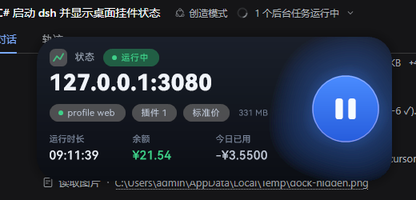

# DSH 状态挂件（C# 桌面 Widget）

一个 Windows 桌面小挂件：**不自动拉起服务**，发现本机已经运行的 `dsh web` 就附着上去，
在桌面上用一张圆角卡片显示地址、状态、插件数、运行时长、余额与今日已用；
右侧大圆钮就是启停开关——运行中显示暂停（点击 = 停止），已停止显示播放（点击 = 启动 `dsh web --no-open`）。



未运行时的样子（圆钮变播放键，点一下就等于执行 `dsh web --no-open`）：


## 功能

版式：`状态胶囊` + `大号地址` + `标签胶囊` + `底部三栏指标` + `右侧圆形启停键`。
卡片是**不透明**的 30px 大圆角，带一圈柔和投影，没有描边，也没有右上角关闭按钮（隐藏/退出都走托盘）。

字体优先用系统里的 **HarmonyOS Sans SC**（Medium / Black 字重按需），没装则回退 Segoe UI；
文字走 GDI+ 灰度抗锯齿，画到带 alpha 的位图上不会出现 GDI 的锯齿。

| 区域 | 内容 | 来源 |
| --- | --- | --- |
| 状态 | 运行中 / 启动中 / 已停止 / 异常 | 监听端口 + HTTP 探活 |
| 地址 | `127.0.0.1:3080`（点它打开 Web UI） | 从进程监听表反查 |
| 标签 | `profile web`、`插件 1`、`标准价`/`闲时` | profile 清单的已装插件包 + 北京时间 |
| 指标 | `运行时长`、`余额 ¥24.45`、`今日已用 -¥0.6400` | 进程启动时间 + DeepSeek `/user/balance` |
| 小字 | `268 MB · 3%` | 进程工作集 + 处理器时间差（悬停卡片有完整详情） |

交互：

- **拖动** 卡片任意位置移动，坐标自动记住（任何位移都会延迟 0.6 秒写盘，重启回到原位）。
- **贴边隐藏** 把卡片拖到屏幕左/右边缘松手，它就吸附并滑出屏幕，只留 8px；鼠标移到那条边缘的热区会以 ~45fps 的缓动滑回来，鼠标离开约 0.5 秒再滑出。托盘可整体关闭该特性。
- **点地址 / 双击卡片空白处** 打开 Web UI（挂件自己启动的实例会带上带 token 的地址，直接免登录；外部实例打开 `http://127.0.0.1:端口/`，浏览器里已有 cookie 的话同样免登录）。
- **右侧大圆钮** 启动 / 停止；停止外部实例前会二次确认。
- **锁定** 开启鼠标穿透（点击落到下面的窗口），卡片上会多一个「已锁定」小标签；
  同时**光标附近会出现一块渐变透明的「探照灯」**，方便看清被卡片挡住的窗口内容。解锁要从托盘来。
- **托盘图标** 右键：弹出**自绘卡片菜单**（和挂件同一套配色/圆角/阴影/HarmonyOS 字体）。
  顶部一行三个图标按钮：打开 / 停止 / 重启；第二行是窗口层级三选一：挂件模式 / 始终置顶 / 普通窗口；
  下面是锁定、贴边隐藏、外壳关闭行为、**开机启动**（写 `HKCU\...\Run`，指向当前 exe）、显示/隐藏挂件、复制地址、打开日志、退出。
  菜单只在第一次右键时创建，之后复用。

## 插件数怎么算

挂件上的 `插件 N` 对齐的是 **Web UI → 设置 → 插件 → 「已安装插件」那组卡片**，也就是
`<DSH_HOME>/profiles/<profile>/package.json` 里 `dependencies` 真正装进来的插件包，并排除
随 DSH 一起发布的组合包（`dsh-base`、`dsh-web-app`、`dsh-headless`、`dsh-sdk-app`、`dsh-acp-app`、`dsh-sdk-minimal`）——
这和插件页面自己的过滤规则（`BUILTIN_PROFILE_BUNDLES` / `installed` 判定）一致。

所以你这个 profile 显示的是 **1**（`@tencent-connect/dsh-qqbot`）。悬停卡片能看到具体包名。

> 早先版本用的是 `dsh --profile web --dump-config` 的条目总数（192 项），那个数是「loader 配置条目」，
> 把每个客户端 UI 面板、每个工具都算一条，跟插件页面的卡片数不是一个口径，已改掉。
> 想看那个数可以在冒烟测试输出里找到（`（参考）组合配置条目数`）。

## 运行

```powershell
# 直接运行（需要已安装 .NET 10 桌面运行时）
.\dist\DSH-Orbit.exe

# 首次运行后会在桌面右下角出现卡片；
# 觉得看不见很正常——默认「置于所有窗口之下」，被窗口挡住时按 Win+D 看桌面，或从托盘切到「始终置顶」。
```

命令行开关（主要给调试/临时摆放用，不写回配置）：

```
--x 40 --y 700      指定初始位置
--top / --bottom    强制置顶 / 置底
--port 3999         优先附着的端口（默认 3080）
--hidden            启动时不显示卡片（只留托盘）
--show-window       启动后直接打开 Web 外壳窗口（dsh 没在跑会先拉起来）
--autostart-full    开机自启用：挂件 + 自动拉起 dsh web
```

## 命令行入口（同一个 exe）

只有一个二进制 `dist\DSH-Orbit.exe`：双击是挂件，带参数是命令行。
给 NewPilot 这类外部工具当「替代 Copilot」的入口用：

```powershell
DshStatus --show-window      # 保证挂件在跑 + dsh web 在跑 + Web 窗口摆到前台
DshStatus                    # 不带参数等价于 --show-window
```

行为细节：

- **挂件没在跑**：直接以 `--show-window` 启动它；如果 3080 上没有 dsh，会先 `dsh web --no-open`，
  等端口就绪（最多 ~16 秒）再开外壳，所以你不需要额外等。
- **挂件已经在跑**：通过命名管道 `DSH-Orbit.command` 通知已有实例开窗口（约 120 ms 返回），
  不会起第二个进程、也不会重复初始化 WebView2。
- 仍然只有一个实例：进程内互斥量保证单例，后启动的进程只转发命令就退出（实测 32 ms，进程数仍为 1）。
- 双击（不带参数）只启动挂件卡片，不弹 Web 窗口；只有 `--show-window` 才连窗口一起开。

## 配置文件

`%LOCALAPPDATA%\DSH-Orbit\config.json`（首次运行自动生成，退出前不写盘；改动需重启挂件）：

```jsonc
{
  "X": 1459, "Y": 65,               // 卡片坐标（460×180），-1 表示用默认的右下角
  "AlwaysBottom": true,             // 置于所有窗口之下（默认，桌面挂件模式）
  "AlwaysOnTop": false,             // 始终置顶（与上者互斥）
  "Opacity": 1.0,                   // 1.0 = 完全不透明；调低会整体变淡（探照灯除外）
  "Profile": "web",                 // 统计哪个 profile 的插件
  "PreferredPort": 3080,
  "DshExePath": null,               // 找不到 dsh 时手动指定，如 "C:\\Users\\你\\.bun\\bin\\dsh.exe"
  "WorkingDirectory": null,          // 启动 dsh 的工作目录，默认用户主目录
  "LaunchArguments": "web --no-open",// 等价于 dsh web --no-open
  "ShowBalance": true,
  "DeepSeekApiKey": null,           // 留空则读 DEEPSEEK_API_KEY 或 ~/.dsh/.credentials.yaml
  "ClickThrough": false,            // 锁定（鼠标穿透）
  "EdgeHideEnabled": true,          // 贴边隐藏
  "DockSide": 0,                    // 0=不吸附 1=左边 2=右边
  "StatusIntervalSeconds": 3,
  "BalanceIntervalSeconds": 60,
  "PluginIntervalSeconds": 300
}
```

## 余额与「今日已用」怎么算

- 余额：每 60 秒请求一次 `https://api.deepseek.com/user/balance`，取 CNY 账户 `total_balance`。
- 今日已用：**按余额下降累计**——和 [DeepSeek-Balance-Whale-Widget](https://github.com/MeteorNOX/DeepSeek-Balance-Whale-Widget) 的记账口径一致。
  余额下降记为消费，余额上升（充值/赠金）只记充值、不冲抵消费。数据存在 `usage.json`，跨重启保留。
  注意：这是「观测口径」，挂件启动之前当天已经发生的消费不会追补；当天第一次取到余额是基准线。
- 时段：北京时间 00:30–08:30 显示「闲时」（DeepSeek 优惠时段），其余「标准」。

## 多实例怎么处理

机器上同时跑着多个 `dsh web` 时（比如 3080 一个、别的端口一个），挂件：

1. 枚举所有**回环地址上的监听端口**，只保留属于 `node/dsh/bun` 进程的；
2. 按 `3080 → 配置端口 → 其余` 的顺序逐个 HTTP 探活，认「401 + `dsh web authentication required`」或前端首页；
3. 附着到第一个命中的，卡片显示该实例端口；**停止**只结束这个实例。

## 构建

```powershell
# 依赖：.NET 10 SDK（已含 WindowsDesktop 运行时）
.\build.ps1            # 发布单文件 exe 到 dist\
```

产物（都是一整个 exe，双击即用）：

| 目录 | 大小 | 依赖 |
| --- | --- | --- |
| `dist\DSH-Orbit.exe` | ~47 MB | **自带 .NET 运行时**，拷到别的机器直接跑；仍需要系统装有 WebView2 运行时 |
| `dist-lite\DSH-Orbit.exe` | ~1.4 MB | 需要 .NET 10 桌面运行时 |

`build.ps1` 会同时产出这两份。

冒烟测试（会真的起一个独立 profile 的 dsh，跑完自动关掉）：

```powershell
cd tests\Harness
dotnet run -c Release
```

它会自动准备 `~/.dsh/profiles/widgettest`（从 web 复制并剥掉 QQ 机器人，避免二次登录），跑完自动关掉；
这个 profile 会保留下来供下次运行，不需要了直接删目录即可。

## Web 外壳（WebView2）

点卡片上的 `127.0.0.1:3080` 或托盘「打开」，不再调起默认浏览器，而是打开内置的 **WebView2 外壳窗口**
（需要本机装有 WebView2 运行时；没有则自动回退到默认浏览器）。

- 窗口自带一条工具栏：可编辑的地址栏（回车跳转，`Ctrl+L` 聚焦）、`刷新`、`浏览器打开`，
  右上角是 macOS 风格红绿灯（黄=最小化、绿=最大化、红=关闭，顺序与原来一致，命中区 32px）。
- **窗口行为走系统逻辑**：保留原生 `WS_THICKFRAME/MAXIMIZEBOX`，用 `WM_NCCALCSIZE` 去掉原生标题栏，
  `WM_NCHITTEST` 把标题栏区域交回 `HTCAPTION`、边缘 6px 交回 `HTLEFT/HTTOP/...`。
  于是拖动标题栏、双击最大化、拖到屏幕顶部贴边吸附、贴边分屏、`Win+↑`、最小化到任务栏、
  任务栏点击还原——全都是 Windows 自己的行为；最大化按工作区内缩（不会盖住任务栏）。
- **可缩放**：客户区铺满整窗后，边缘的命中会被子控件（WebView2/面板）吃掉，所以自绘面板在
  距窗口边缘 8px 内返回 `HTTRANSPARENT`、WebView2 四周内缩 6px 让出一条边框带；
  拖动任意边/角都能缩放（最小 880×620），和原生窗口手感一致。
- **新标签页（原生 C# 绘制，不是网页）**：
  - 顶部搜索框：左侧是**当前引擎图标 + 下拉**（默认百度/必应/谷歌，图标取自各站 favicon；
    下拉里可切换，最后一项「添加搜索引擎…」可自定义名称和 `{q}` 模板），右侧是搜索按钮。
  - 配色跟随 DSH 的蓝色主题：标题里的「DSH」用 `#6E9CF0`（比 `#7AAAFF` 略深），
    标题栏小圆点、搜索按钮悬停、引擎选中态也都用蓝色，不再用挂件的绿色。
  - 下面是 4×4 宫格：左上 **3×3** 是一整块「打开 DSH」大入口（大字号标题 + 地址），
    其余 7 格是最近访问的页面（首字母色块 + 标题 + 域名，点击直达）。
  - DSH 自己的地址（回环地址）根本不写入访问记录，保证入口只有「打开 DSH」这一处。
  - **删除记录**：鼠标悬停在某个记录格上，右上角出现红色 `×`，点它删除这一条；
    右键菜单里还有「清空访问记录」。
  - **自定义背景**：新标签页右键 → 选择背景图片 / 清除背景（自动覆盖裁切 + 暗色蒙版）。
  - 搜索引擎、访问记录、背景路径都存在 `shell.json`。
- **多标签页**：标签条在标题栏下方，`+` 或 `Ctrl+T` 新开一个，`Ctrl+W` 关闭当前，
  标签标题取页面 `document.title`，悬停显示关闭按钮；`Ctrl+T/W/L` 通过 WebView2 的
  `AcceleratorKeyPressed` 接管，焦点在网页里也生效；标签多到放不下时在标签条上滚轮横向滚动，
  `+` 号固定在右侧；站内 `target=_blank` 也开成新标签页。
  每个标签页是一个独立 WebView2（同一 user-data 目录，共享登录态），只显示当前那个。
- **鉴权**：挂件自己拉起的实例直接加载带 `?token=` 的地址；外部实例没有 token，就用本机
  `~/.dsh/.credentials.yaml` 里的 `client-connection/browser-session` secret，按 dsh 自己的格式签一个
  12 小时的本机会话 cookie 塞给 WebView2（名字 `dsh-auth-<base64url(sha256(authority))>`，
  值 `v1.<payload>.<hmac-sha256>`）。等价于你手动用启动时打印的 token 打开一次，但不用复制粘贴。
  只对回环地址签发，secret 只在内存里用，不落盘、不外发。
- **免登录打开 / 复制**：`dsh web` 的 launch token 是进程启动时随机生成、只存在它内存里的，
  外部启动的实例拿不到，会话中断重启后也会变。所以挂件起了一个本地中转
  `http://127.0.0.1:<端口>/open?to=<dsh 地址>`：浏览器先访问它，挂件用
  `~/.dsh/.credentials.yaml` 里的持久 secret 现签一个 12 小时会话 cookie 一起返回，
  再 302 跳到 dsh 页面。右键「复制登录地址」和外壳的「在浏览器打开」都走这条链路，
  即使 dsh 重启换了端口也不会再看到 “authentication required”。
  只允许跳回本机地址（防止变成开放重定向）。
- 再点一次地址（或按 `Esc`、点窗口关闭按钮）时，按设置二选一：
  - **隐藏**：窗口收起，WebView2 留在后台，下次打开秒开（默认）；
  - **退出**：窗口和 WebView2 一起销毁，不占后台内存。
  托盘菜单里的「外壳关闭时：隐藏 / 退出」可以随时切换，存在 `config.json` 的 `ShellClose`。
- WebView2 的缓存目录放在 `%LOCALAPPDATA%\DSH-Orbit\webview`，和系统 Edge 分开。

## 图标

全程序（挂件、托盘菜单、外壳标题栏/标签条）统一使用 **Lucide** 图标，几何来自 `lucide-static` 官方 SVG，
不是手绘近似：

- `tools/fetch-lucide.ps1` 从 `cdn.jsdelivr.net/npm/lucide-static` 拉取所需 SVG，抽出 `path`/`rect`/`circle`/`line`/`polyline`/`polygon`
  的几何，生成 `LucideData.cs`（源文件也留一份在 `assets/lucide/`）。
- `SvgPath.cs` 是一个小的 SVG path 解析器，支持 `M/L/H/V/C/S/Q/T/A/Z`（含相对指令、紧凑弧旗标），
  圆弧按 ≤11.25° 折线细分；`Icons.cs` 把几何缓存成 `GraphicsPath`，按 24×24 视口等比缩放到目标尺寸，
  2 单位描边、圆头圆角。
- 图标清单：`docs/icons.png`（`RenderPreview --icons` 生成）。

## 性能

- **冷启动**：从进入 Main 到窗口可见实测 **~190–220 ms**（优化前稳定在 235 ms 左右）。
  启动路径上只做「窗口 + 一次端口探测」，其余全部后置：
  - 版本号改成直接读 CLI 的 package.json，不再 spawn 一个 dsh -V 进程；
  - 插件清单、余额请求延后 1.2 秒（此时窗口早就在了）；
  - 托盘菜单**按需创建**，不再在启动时构建 ContextMenuStrip；
  - 字体族探测从「枚举全部字体」改成「构造失败即回退」，省掉一次全量枚举。
- **常驻内存**：约 **75 MB** 工作集，基本是 .NET 10 WinForms 的基线；挂件本身只保留一张 476×212 的位图和几个计时器。
- 想要更低的冷启动只能改成自包含 + ReadyToRun（体积会从 ~260 KB 涨到几十 MB），当前取舍是「小体积优先」。

## 已知限制

- 置底模式下被最大化窗口挡住时看不到卡片，这是「桌面挂件」的预期行为；需要常驻可见请在托盘里切「始终置顶」。
- 「今日已用」是观测累计，不是平台账单；同一天里挂件没跑的时间段不会计入。
- 只监控本机回环监听的实例，不处理反向代理 / `--public-url` 场景。
- 用鼠标穿透锁定时卡片上的按钮点不动，只能通过托盘解锁；此时圆钮仍显示，光标附近的「探照灯」可以看清下面被挡住的内容。
- 字体按 HarmonyOS Sans SC → HarmonyOS Sans → Segoe UI 的顺序回退，没装也能正常显示，只是字形不同。

## 命名与标志

- 产品名：**DSH-Orbit**（挂件 + Web 外壳，绕着 dsh 转的那圈轨道）。
- 标志：三段圆弧构成的光圈 + 中心的 DSH 官方鲸鱼标（取自 dsh-web-frontend/dist/favicon.svg，DSH 是开源项目）。
  几何在 OrbitMark.cs / DshMark.cs 里用 GDI+ 直接画，托盘 16px、标题栏 18px、exe 图标共用同一份代码；	ools/IconGen 生成 pp.ico（16–256 全尺寸）。

## 目录

```
DSH-Orbit.csproj   工程（net10.0-windows, WinForms, 单文件发布，产物名 DSH-Orbit.exe）
Program.cs               入口、单实例、命令行开关
WidgetApp.cs             托盘、定时刷新、进程/余额/插件协调
WidgetForm.cs            挂件绘制与鼠标交互
DshServices.cs           dsh 发现、启停、token URL 捕获、插件统计
SingleInstance.cs        DshStatus --show-window 的命名管道命令通道
DshSession.cs            本机会话 cookie 签发（外部实例免 token 登录）
WebShell.cs              WebView2 外壳（自绘标题栏 + 多标签页）
Icons.cs / SvgPath.cs / LucideData.cs   Lucide 图标（官方 SVG 几何）
Balance.cs               余额与今日用量
Models.cs                配置与状态模型
Native.cs                窗口样式/圆角/监听端口表 P/Invoke
IconFactory.cs           托盘图标
tests/Harness            端到端冒烟测试（真启停一次 dsh）
tests/Render             离屏渲染两种状态，产出 docs/ 里的截图
```
