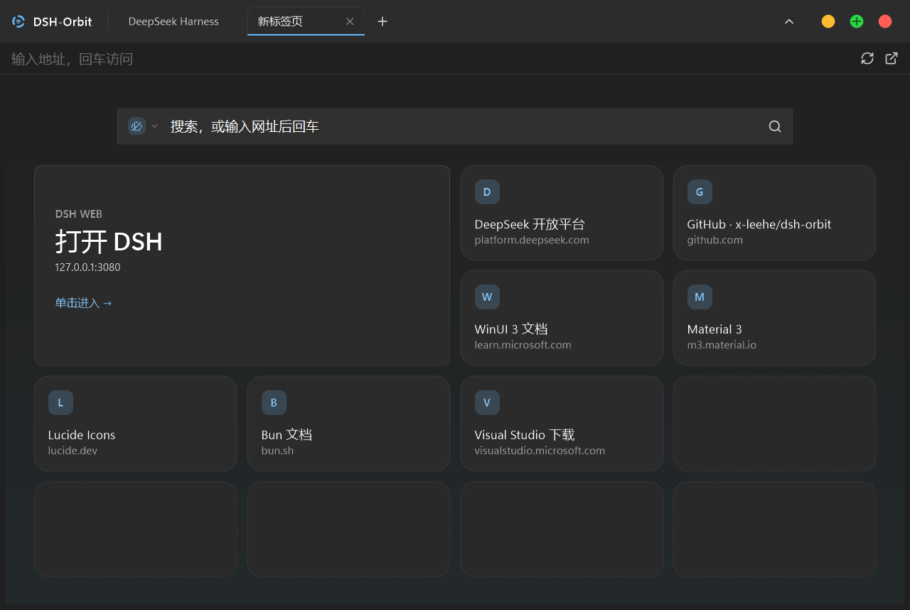
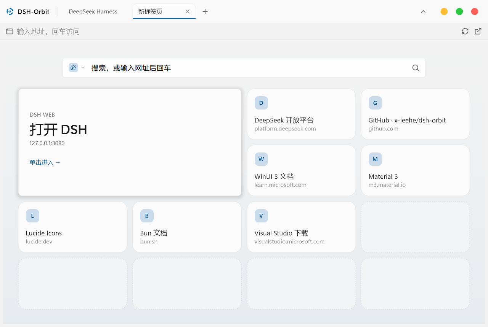
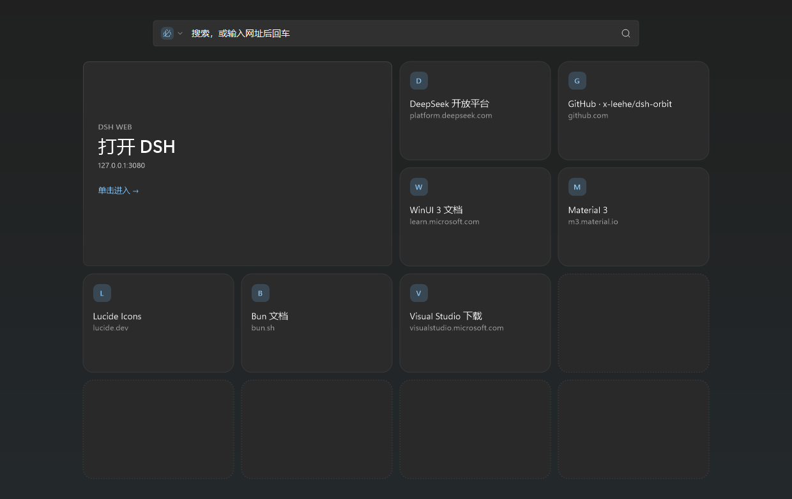
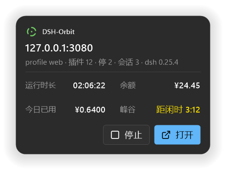
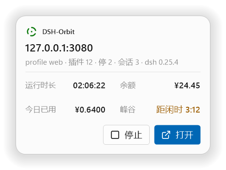
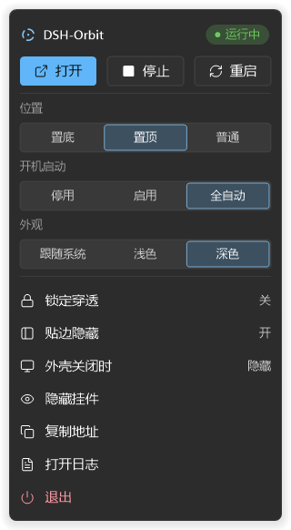
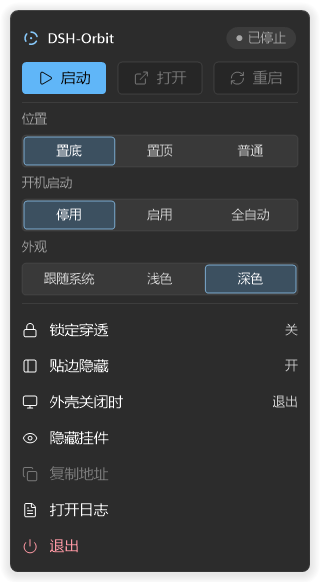
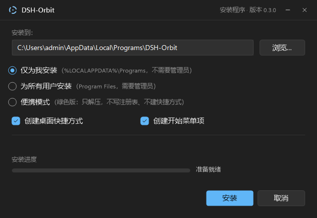

<div align="center">


# DSH-Orbit

**给 `dsh web` 用的桌面挂件 + 浏览器外壳。**

[](LICENSE)
[](AGENTS.md)
[](#下载)
[](https://dotnet.microsoft.com)
[](docs/design-fluent.md)

</div>

## 它做什么

把 DSH 的状态做成一张常驻桌面的小卡片，同时用 WebView2 外壳代替系统浏览器打开 DSH Web：

- 卡片显示端口、插件数、运行时长、内存/CPU、余额和今日已用；
- 点地址在自带的浏览器窗口里打开 DSH，而不是跳系统浏览器；
- 托盘菜单负责启动/停止/重启、层级、贴边隐藏、开机启动；
- 界面按 **WinUI 3（Fluent）** 规范重画，融合少量 **Material 3**，跟随系统浅色/深色与系统强调色。

## 截图

**Web 外壳**（WinUI 3 式标题栏、多标签、macOS 风格红绿灯）：



**浅色主题**（同一套界面跟随系统深浅色）：



**新标签页**（原生 C# 绘制，不是网页；Fluent + Material 3 磁贴）：



**挂件**（平时只是贴边的一枚图标，运行中自己转；鼠标靠近才长大成浮层。完全收起时留一根 6×28 的拉手，颜色即状态。深色 / 浅色）：

   

**托盘菜单**（运行中第一格是「打开」；停止时会换成可点的「启动」）：

 

## 界面

界面语言取自 [WinUI 3](https://learn.microsoft.com/windows/apps/winui/winui3)（Fluent）与 [Material 3](https://m3.material.io/)：

- 圆角只有四档：控件 `4`、卡片/浮出层 `8`、磁贴 `16`、药丸 `999`；
- 版式走 WinUI 的 `Caption 12 / Body 14 / Subtitle 20 / Title 28` 阶梯，字体 `Segoe UI Variable`；
- 配色跟随系统深浅色与**系统强调色**，菜单「外观」里可强制浅色或深色；
- 悬停/按下用 8%/10% 状态层（M3），浮层用抬升阴影，磁贴悬停抬升一级。

全部令牌与绘制原语集中在 `Fluent.cs`，完整规范见 [docs/design-fluent.md](docs/design-fluent.md)。

## 功能

**挂件**
- 端口 / 插件数 / 运行时长 / 内存 / CPU / 余额 / 今日已用，1 秒刷新
- 置于所有窗口之下（不挡事）、置顶、普通窗口三态
- 贴边隐藏：吸附到左右边缘，鼠标移到热区滑出
- 锁定穿透：鼠标穿透，略微透明
- 记住上次位置，重启后回到原处

**Web 外壳**
- 无边框自绘标题栏；红绿灯按钮走系统 `ShowWindow`，拖动、贴边吸附、`Win+↑`、最小化动画都是原生行为
- 多标签页：`+` / `Ctrl+T` 新建，`Ctrl+W` 关闭，滚轮横向滚动
- 编辑地址栏，`Ctrl+L` 聚焦，回车跳转；刷新与"在浏览器打开"就在地址框内
- 地址栏可收起（标题栏右上角 `⌃`），收起后网页区多出 36px，`Ctrl+L` 会自动展开
- 关闭行为可选「隐藏（WebView 留后台）」或「退出」

**托盘菜单**
- 打开 / 停止 / 重启
- 置底 / 置顶 / 普通
- 开机启动三态：停用 / 启用（只起挂件）/ 全自动（连 `dsh web` 一起拉起）
- 外观三态：跟随系统 / 浅色 / 深色
- 键盘操作：↑↓ 移动、Enter 触发、Esc 关闭
- 锁定穿透、贴边隐藏、外壳关闭行为、复制登录地址、打开日志

## 前置条件

本程序**不包含 dsh 本体**，只是它的客户端，所以需要先让它那边的 `dsh web` 能跑起来：

- 用 `bun` / `npm` 全局安装 DSH 都行；程序会自动在 `PATH`、`~\.bun\bin`、`%APPDATA%\npm` 里找 `dsh.exe` / `dsh.cmd`；
- 找不到时，**卡片上会直接显示提示**（不是一闪而过的通知），也可以在 `config.json` 的 `DshExePath` 里写死路径；
- 如果 `dsh.cmd` 还在但 Node/Bun 被卸载了，进程会启动即退出，错误在 `%LOCALAPPDATA%\DSH-Orbit\logs\dsh-*.log`；
- 另外需要 **WebView2 运行时**（Win10/11 一般自带）。

## 下载

从 [Releases](https://github.com/x-leehe/dsh-orbit/releases) 下载：

| 文件 | 大小 | 依赖 |
| --- | --- | --- |
| `DSH-Orbit-Setup.exe` | ~94 MB | **推荐**。安装器，**不需要预装 .NET** |
| `DSH-Orbit.exe` | ~47 MB | 绿色单文件，自带 .NET 运行时，拷走就能跑 |
| `DSH-Orbit-lite.exe` | ~1.5 MB | 需要 [.NET 10 桌面运行时](https://dotnet.microsoft.com/download/dotnet/10.0) |

三者都还需要系统装有 **WebView2 运行时**（Win10/11 一般自带）。

双击启动挂件；`DSH-Orbit.exe --show-window` 会连 Web 窗口一起打开。

## 安装

`DSH-Orbit-Setup.exe` 是自研的 7-Zip 风格安装器：**一个窗口、一张脸**，没有向导页，也不用 Inno Setup / NSIS / MSI。



- **安装到**：任意目录，带「浏览…」
- **三档范围**
  - 仅为我安装：`%LOCALAPPDATA%\Programs\DSH-Orbit`，不弹 UAC，注册表写 HKCU
  - 为所有用户安装：`C:\Program Files\DSH-Orbit`（若已有 `Program Files (x86)\DSH-Orbit` 就沿用它），需要管理员
  - 便携模式：只解压，不写注册表、不建快捷方式，数据存在 exe 旁边的 `data\`
- **快捷方式**：桌面 / 开始菜单，各一个勾选框
- **软件索引**：写入「应用和功能」（`Uninstall\DSH-Orbit`）和 `RegisteredApplications`，卸载时一并清除
- **静默安装**（给脚本/批量部署用）：`DSH-Orbit-Setup.exe /S /MODE=user /NODESKTOP /NOSTART /D=D:\Apps\DSH-Orbit`

卸载走「应用和功能」，或 `DSH-Orbit.exe --uninstall`；默认**保留**配置与访问历史，勾选后才删。

## 命令行

```powershell
DSH-Orbit --show-window   # 保证挂件在跑 + dsh web 在跑 + Web 窗口在前台
DSH-Orbit                 # 不带参数 = 只启动挂件卡片
DSH-Orbit --uninstall     # 卸载（应用和功能里的卸载项也指向这里）
```

只有一个进程：已运行时再调用只会通过命名管道通知已有实例，然后退出。

其它调试开关：`--x 40 --y 700`、`--top` / `--bottom`、`--port 3999`、`--hidden`、`--autostart-full`。

## 关于登录

`dsh web` 的 launch token 是进程启动时随机生成、只存在内存里的，外部启动的实例拿不到，会话重启后也会变。
所以挂件起了一个本地中转：

```
http://127.0.0.1:<临时端口>/open?to=<dsh 地址>
```

浏览器先访问它，挂件用 `~/.dsh/.credentials.yaml` 里的 secret 现签一个 12 小时会话 cookie 一起返回，再 302 跳到 DSH。
右键「复制登录地址」和外壳的「在浏览器打开」都走这条链路，dsh 换端口也不会再报 `authentication required`。

只接受回环地址，避免变成开放重定向。

## 构建

需要 .NET 10 SDK 和 Windows 10/11。

```powershell
git clone https://github.com/x-leehe/dsh-orbit.git
cd dsh-orbit

dotnet build -c Release            # 编译
.\build.ps1                        # 产出 dist\DSH-Orbit.exe 和 dist-lite\DSH-Orbit.exe
```

单元测试（纯逻辑：SVG 路径解析、颜色/缓动、余额时段、登录链接、菜单状态）：

```powershell
dotnet test tests/Unit/Unit.csproj -c Release
```

冒烟测试（会自动建 `~/.dsh/profiles/widgettest` 并起一个隔离实例）：

```powershell
dotnet run --project tests/Harness -c Release
```

生成图标与截图（`Render` 会把每个界面渲成浅色/深色两套）：

```powershell
dotnet run --project tools/IconGen -c Release -- .
dotnet run --project tests/Render -c Release -- artifacts/gallery
dotnet run --project tests/Render -c Release -- artifacts/gallery --only menu
```

## 项目结构

```
DshOrbit.csproj        主工程（net10.0-windows, WinForms, 单文件发布）
Program.cs             入口：单实例、命令行开关
Fluent.cs              设计令牌与绘制原语（WinUI 3 × Material 3）
FluentControls.cs      Fluent 按钮 / 输入框（对话框用）
WidgetForm.cs          挂件（贴边图标 ⇄ 浮层接力变形，分层窗口 + 自绘）
WidgetApp.cs           状态机：探测、启停、托盘、外壳、管道命令
WebShell.cs            WebView2 外壳（自绘标题栏 + 多标签）
StartPage.cs           新标签页（原生绘制）
TrayMenuForm.cs        托盘右键菜单
AddEngineDialog.cs     添加搜索引擎对话框
DshServices.cs         dsh 发现 / 启动 / 插件统计
Balance.cs             DeepSeek 余额与今日用量
LoopbackAuthServer.cs  本地登录中转
Icons.cs / SvgPath.cs / LucideData.cs / OrbitMark.cs / DshMark.cs   图标与标志
docs/design-fluent.md  界面规范（令牌、版式、每个界面的规格）
tests/Unit/            单元测试（xUnit）
tests/Harness/         冒烟测试（起隔离 dsh 实例）
tests/Render/          离屏渲染，产出浅/深两套截图
tools/                 图标生成、Lucide 数据抓取
```

## AIGC 声明

**本项目是 AI 生成内容（AIGC）。** 代码、文档与图标主要由 DeepSeek Harness 中的 `deepseek-flash` 生成，
经人工提出需求、审阅与迭代。它按「能跑、可读」的标准写的，不保证经过同等强度的工程审查，
使用前请自行评估风险；发现问题欢迎提 issue。

更多协作约定见 [AGENTS.md](AGENTS.md)。

## 鸣谢

- **[DeepSeek-Balance-Whale-Widget](https://github.com/MeteorNOX/DeepSeek-Balance-Whale-Widget)**（MIT）—
  **余额/用量展示的灵感来源**。它把 DeepSeek 余额做成住在 DSH 界面角落的一只小鲸鱼娘，随界面自动出现；
  本项目借的是「把余额和今日消耗摆在显眼处」这个思路，界面与代码均为独立实现。
- **[DSH / DeepSeek Harness](https://github.com/deepseek-ai)** — 本项目服务的对象；标志中心的鲸鱼取自
  `dsh-web-frontend/dist/favicon.svg`，登录 cookie 的签名方式参考了 `dsh-client-connection` 的实现。
- **[Lucide](https://lucide.dev)**（ISC）— 全部界面图标。`tools/fetch-lucide.ps1` 从 `lucide-static` 抓官方 SVG，
  `SvgPath.cs` 解析 path 数据后由 GDI+ 渲染，没有手绘近似。
- **[Microsoft WebView2](https://learn.microsoft.com/microsoft-edge/webview2/)**（BSD-3-Clause）— 嵌入式浏览器内核。
- **[FlClash](https://github.com/chen08209/FlClash)** — 交互与视觉参考（卡片式布局、贴边隐藏、托盘菜单的组织方式）。
  **未使用其任何代码**（FlClash 为 GPL-3.0，本项目为 MIT）。
- **[.NET](https://dotnet.microsoft.com)** / WinForms — 运行时与 UI 框架。
- **[WinUI 3 设计规范](https://learn.microsoft.com/windows/apps/winui/winui3)**（MIT 文档）— 几何、版式、间距、配色语言的依据。
- **[Material 3](https://m3.material.io/)**（Apache-2.0）— 状态层、抬升、形状阶梯的参考。
- **Segoe UI Variable** — 界面字体（Windows 11 系统自带，仓库不打包字体文件）。

## License

[MIT](LICENSE) © 2026 x-leehe
